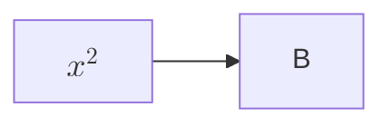
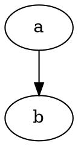

# Notes

Inline $x^2$ and a price of $5 and $6 here, and \$7 stays. Code `$y$` too.

$$
\int_0^1 x\,dx
$$



```math
\frac{a}{b}
```

- item with $a+b$
  and display $$c$$ inline

> quote with $q$
>
> $$
> r^2
> $$

```rust
let s = "$not math$";
```

    $indented$

```latex
$$ \sqrt{2} $$
```



Final $$ z $$ here.
