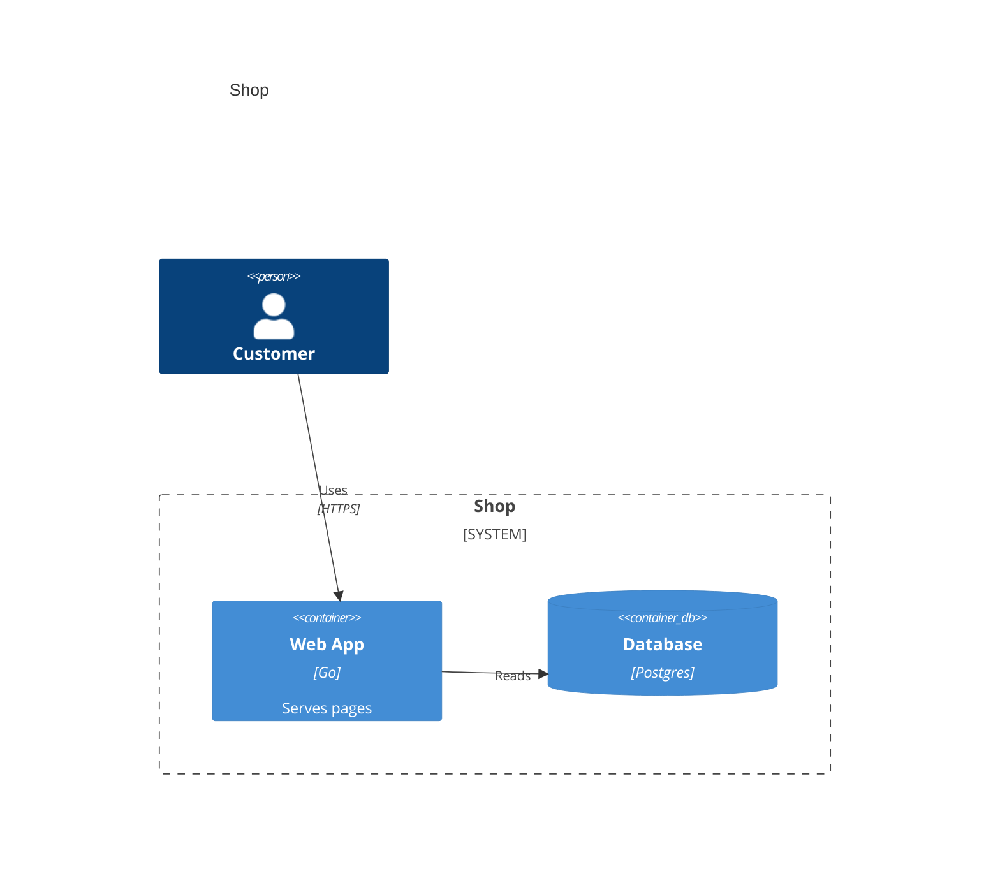

# C4 diagrams

sirene draws Mermaid C4 diagrams (`C4Context`, `C4Container`, `C4Component`, `C4Dynamic`, and
`C4Deployment`) as images and as text. Elements fill rows from the left, boundaries go below
them, and in text the relations are listed under the drawing:

See `crates/sirene-core/tests/fixtures/c4/valid/` for context, container, and deployment
diagrams. In the editor a C4 diagram is read-only on the drawing side.

## What is read

| Syntax | Drawn as |
|---|---|
| `Person`, `System`, `Container`, `Component` | a box with its `<<type>>`, label, `[technology]`, and description; a person has an icon |
| `...Db`, `...Queue` (e.g. `SystemDb`, `ContainerQueue`) | a cylinder, upright or lying down |
| `..._Ext` (e.g. `Person_Ext`, `SystemDb_Ext`) | the external colors |
| `Boundary`, `Enterprise_Boundary`, `System_Boundary`, `Container_Boundary` | a dashed box titled at the top left with its kind |
| `Deployment_Node`, `Node`, `Node_L`, `Node_R` | a solid box titled at the top left |
| `Rel`, `Rel_U`, `Rel_D`, `Rel_L`, `Rel_R`, `RelIndex` | an arrow with its label and `[technology]` |
| `Rel_Back`, `BiRel` | an arrow the other way, or both ways |
| `UpdateElementStyle`, `UpdateRelStyle` | the colors given by `$bgColor`, `$fontColor`, `$borderColor`, `$textColor`, `$lineColor` |
| `UpdateLayoutConfig` | `$c4ShapeInRow` elements and `$c4BoundaryInRow` boundaries per row |
| `title`, frontmatter `title` | the title above |
| `accTitle`, `accDescr` | read, not drawn |

Arguments go by position or by name (`$descr="..."`) and may be quoted.

## Errors

A statement that is none of the above, an unclosed string, `(`, or `{`, and a stray `}` are
errors. An id declared twice, an element without an alias, and a relation to an unknown id are
errors and skipped. A `{` after an element is a warning and its contents are drawn outside it. A
macro that is read but not drawn, such as `AddElementTag` or `Lay_R`, and a row count that is not
a whole number of at least 1, are warnings.

## Not drawn

Tags, sprites, links, relation offsets, and `Rel_U`/`Rel_D`/`Rel_L`/`Rel_R` directions are
ignored, and boundary styles are not drawn. Theme variables are ignored.
