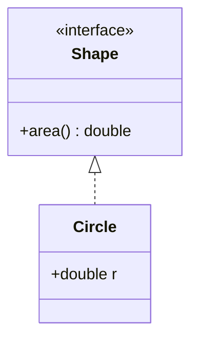

# Class diagrams

sirene draws Mermaid class diagrams (`classDiagram` and `classDiagram-v2`) with the same layout,
themes, and outputs as flowcharts:

In the editor a class diagram is read-only on the drawing side, as state diagrams are.

## What is read

| Syntax | Drawn as |
|---|---|
| `class A`, `class A["Label"]`, `class List~T~` | a box titled `A`, `Label`, or `List<T>`; generics nest (`List~List~int~~` is `List<List<int>>`) |
| ``class `Animal Class!` `` | a class name in backticks, which may hold spaces and punctuation |
| `class A { ... }`, `A : +int id` | members: attributes, then methods (a member with `(`) |
| `+make()$`, `+draw()*` | static members underlined, abstract ones italic |
| `<<interface>>` in a body, or `<<interface>> A` | `«interface»` above the name |
| `<\|--`, `*--`, `o--`, `-->`, `--` | hollow triangle, filled diamond, hollow diamond, arrow, plain line |
| `..>`, `..\|>`, `..` | the same, dotted |
| `A --() B`, `A ()-- B` | a lollipop interface: a small circle at the `()` end |
| `A "1" --> "*" B : label` | cardinalities beside each end, the label in the middle |
| `namespace N { ... }` | a box around its classes |
| `note for A "text"` | a note beside the class |
| `note "text"` | a note on its own |
| `direction`, `classDef`, `cssClass "A,B" name`, `A:::name`, `style` | as in flowcharts |

An edge runs from the left class to the right one, so in `Super <|-- Sub` the superclass is drawn
above. Space around the relation is optional (`Duck-->Egg`), except for an `o` end: write
`A o-- B` and `A --o B`.

In ASCII the markers are `△` (`^`), `◆` (`*`), and `◇` (`o`), pointing the way the triangle
does.

## Not drawn

These are warnings, and the rest of the diagram is drawn: `click`, `callback`, `link`, and
styling of a class that does not exist.
