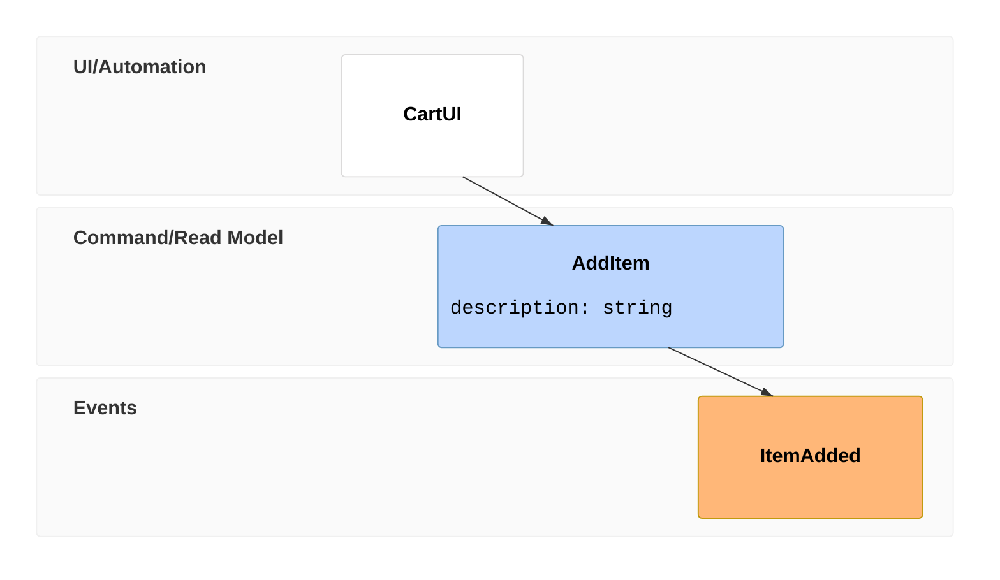

# Event modeling diagrams

sirene draws Mermaid's event modeling diagrams (`eventmodeling`) as images and as text: UI,
processor, command, read model, and event frames along a timeline, in swimlanes, with relations
between them.

See `crates/sirene-core/tests/fixtures/eventmodel/` for more. In the editor an event modeling
diagram is read-only on the drawing side.

## Syntax

- `eventmodeling` first, then `title`, `accTitle`, and `accDescr` as usual. Comments are `%%`,
  `//`, or `/* ... */`.
- `tf NN type Name` (or `timeframe`) adds a time frame. `NN` is a frame number of one to three
  digits, unique in the diagram. `type` is `ui`, `pcr` (`processor`), `cmd` (`command`), `rmo`
  (`readmodel`), or `evt` (`event`).
- `rf NN type Name` (or `resetframe`) adds a reset frame, which takes no inferred relation.
- After the name: `->> NN` relations from other frames, any number; `[[Data]]` to show a data
  block; inline data in `{ ... }`, `"..."`, or `'...'`, optionally after a type such as
  `` `json` ``.
- `data Name { ... }` defines a data block over the lines below `{`, up to a `}` line.
- `entity`, `note NN { ... }`, and `gwt NN given ... when ... then ...` are read but not drawn.

A frame with no `->>` takes a relation from the latest earlier frame in another lane. A
`->>` source of the wrong type (a command's must be a UI or processor, an event's a command, a
read model's an event, and a UI's or processor's a read model) is an error, as are repeated
frame numbers and undefined frames or data blocks.

## Lanes

UIs and processors go in UI/Automation, commands and read models in Command/Read Model, and
events in Events. A name with a namespace, such as `Cart.ItemAdded`, goes in its own lane in
that group (`Stream: Cart`), after the group's lane.

In text, a relation that cannot be drawn as a straight vertical arrow is listed below the
lanes as `01 From → 02 To` (`->` in ASCII).

## Not drawn

Notes, `gwt` scenarios, `entity` declarations, data types, and the `em*` theme variables.
