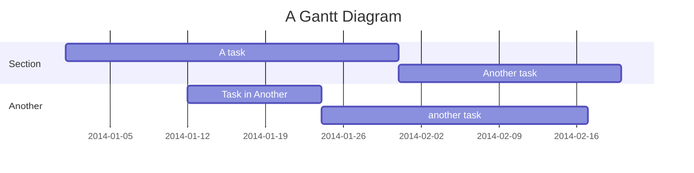

# Gantt charts

sirene draws Mermaid gantt charts (`gantt`) as images and as text:



In the editor a gantt chart is read-only on the drawing side.

## Tasks

`NAME : DATA`, where DATA is comma-separated: optional tags, then `END`, `START, END`, or `ID,
START, END`.

| Part | Values |
|---|---|
| tags | `active`, `done`, `crit`, `milestone` (a diamond), `vert` (a line across the chart) |
| START | a date, or `after ID ID...` (the latest of their ends); left out, the end of the task before |
| END | a date, a duration (`3d`, `1.5h`, `2w`, `30m`, `10s`, `500ms`, `1M`, `1y`), or `until ID ID...` |

## Settings

| Setting | Effect |
|---|---|
| `title`, `section NAME` | the title, and a group of the tasks that follow |
| `dateFormat FORMAT` | how dates are written, as dayjs reads them (default `YYYY-MM-DD`) |
| `axisFormat FORMAT` | how the axis labels are written, in d3's `%` codes (default `%Y-%m-%d`) |
| `tickInterval 1week` | the axis step: a number and `millisecond`, `second`, `minute`, `hour`, `day`, `week`, or `month` |
| `excludes weekends, friday, 2014-01-15` | days a duration skips, shaded grey |
| `includes 2014-01-18` | days never excluded |
| `weekend friday` | the weekend is Friday and Saturday (default `saturday`: Saturday and Sunday) |
| `weekday monday` | the day weekly ticks fall on (default `sunday`) |
| `inclusiveEndDates` | an END date includes that day |
| `todayMarker off` or `todayMarker stroke:#0f0,stroke-width:3px` | hide or style the line at today |
| `topAxis` | repeat the axis above the chart |

`dateFormat` reads strictly: `YYYY-MM-DD` does not read `2014-1-6`. A date that does not match
it is read as ISO 8601 (`2014-01-06T09:30`). Dates have no time zone; today is the current date in
UTC.

The formats, `tickInterval`, `topAxis`, `weekday`, and `displayMode: compact` (tasks of a section
share rows when they do not overlap) can also be set in frontmatter or a directive; a setting in
the chart wins:

```
---
config:
  gantt:
    axisFormat: "%b %e"
    displayMode: compact
---
gantt
    ...
```

## Errors

An unknown `after` or `until` id, tasks that wait on each other, an id used twice, an unreadable
date or duration, a task with no start and no task before it, and an unknown `weekday`, `weekend`,
or `tickInterval` are errors; the task or setting is skipped and the rest is drawn. `click` is a
warning and ignored.

## Not drawn

Pixel settings (`barHeight`, `fontSize`, ...) and the theme colors (`taskBkgColor`, ...) are
ignored.
