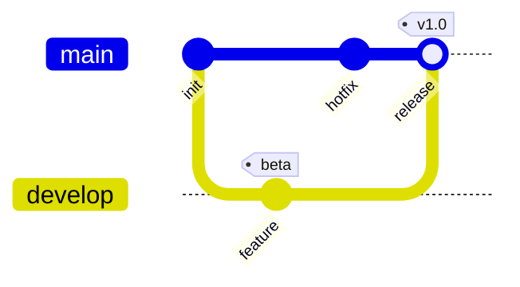

# Git graphs

sirene draws Mermaid git graphs (`gitGraph`) as images and as text:

In images each branch is a lane, left to right by default, with commits in source order. Text
always puts one commit per row, as `git log --graph` does. In the editor a git graph is
read-only on the drawing side.

## What is read

| Syntax | Drawn as |
|---|---|
| `gitGraph`, `gitGraph LR:`, `gitGraph TB:`, `gitGraph BT:` | lanes left to right, top to bottom, or bottom to top |
| `commit` | a circle on the current branch |
| `commit id: "x"` | the id `x`; without one, a stable generated id such as `0-2245cbe` |
| `commit type: REVERSE` / `HIGHLIGHT` | a crossed circle / a filled square (`⊗` / `■` in text) |
| `commit tag: "v1"` | a tag label (`[v1]` in text) |
| `branch name`, `branch name order: 2` | a new lane starting at the current commit |
| `checkout name`, `switch name` | later commits go on that branch |
| `merge name` (with `id`, `tag`, `type`) | a ringed merge commit (`◉`), joined to the merged branch |
| `cherry-pick id: "x"` (with `parent`, `tag`) | a commit tagged `cherry-pick:x` |

`msg:` is read but not drawn. Lanes are ordered as in Mermaid: `main`, then branches without
`order` in the order declared, then the others by `order`.

## Errors

Merging a branch into itself or one with no commits, checking out an unknown branch, reusing a
commit id or branch name, and cherry-picking a commit that is missing, already on the branch, or
a merge without `parent:` are errors on that line; the rest of the graph is drawn.

## Not drawn

`gitGraph` settings in frontmatter `config` (`showBranches`, `mainBranchName`, and the others)
are ignored, and ids are never rotated.
