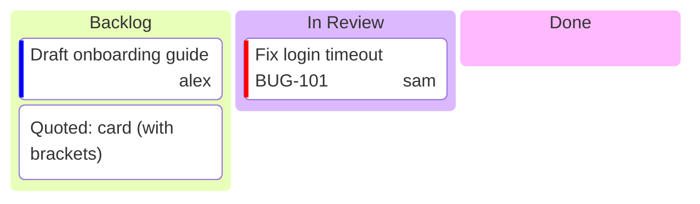

# Kanban boards

sirene draws Mermaid kanban boards (`kanban`) as images and as text:

In the editor a kanban board is read-only on the drawing side.

## What is read

| Syntax | Drawn as |
|---|---|
| a node at the first node's indent | a column, titled by its text |
| a node indented under a column | a card in that column |
| `id[text]`, `[text]`, `text`, `id["text"]` | the column's or card's text, as in mindmaps |
| `@{ assigned: 'name' }` | the assignee, at the card's bottom right |
| `@{ ticket: ID }` | the ticket, at the card's bottom left |
| `@{ priority: 'High' }` | a colored stripe: `Very High`, `High`, `Low`, or `Very Low` |
| `@{ label: 'text' }` | the text, in place of the bracketed one |
| frontmatter `title` | the title above |
| frontmatter `config.kanban.ticketBaseUrl` | kept in the model |

Metadata may span lines. In text, a card's details line shows its priority, ticket, and
assignee.

## Errors

A node indented less than the first column is an error, and it is left out. An unclosed `@{` is
an error. Other metadata keys and unknown priorities are warnings and ignored.

## Not drawn

`::icon(...)` and `:::classes` are read and kept, but not drawn. Tickets are not links.
