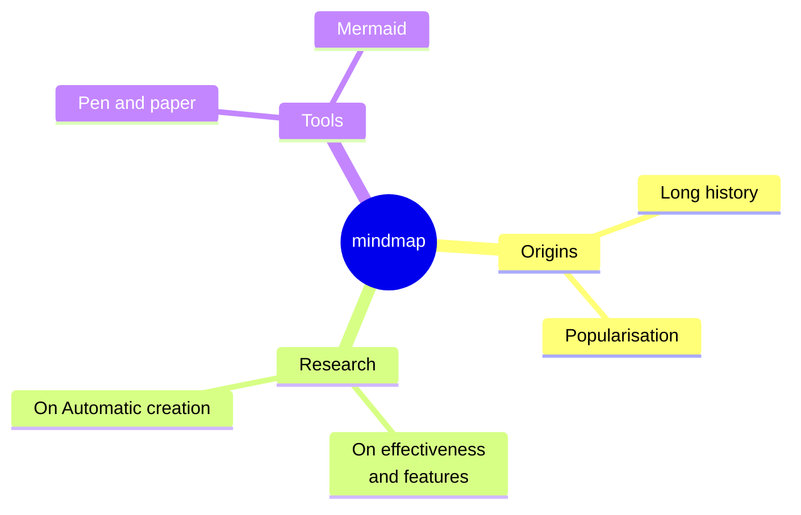

# Mindmaps

sirene draws Mermaid mindmaps (`mindmap`) as images and as text:

In the editor a mindmap is read-only on the drawing side.

## What is read

| Syntax | Drawn as |
|---|---|
| indentation | the tree: a node's parent is the nearest line above it that is indented less |
| `text` | the default shape: a box with a line under it |
| `id[text]` | a square |
| `id(text)` | a rounded box |
| `id((text))` | a circle |
| `id)text(` | a cloud |
| `id))text((` | a bang |
| `id{{text}}` | a hexagon |
| `[text]`, `(text)`, ... | a shape without an id |
| `id["text"]` | quoted text, which may hold `(`, `[`, and the other delimiters |
| ``id["`**bold** *italic*`"]`` | a markdown string, which may span lines |
| ` ` | a line break |
| `:::a b` | classes on the node above, kept in the model |
| frontmatter `title` | the title above |

The root sits in the middle. Its children go down the right side in order until that side holds
about half the height, and the rest down the left. Each of the root's children and everything
under it gets its own color, and edges thin with depth. Text wraps at 200 pixels. In text, each
node shows its shape's delimiters.

## Errors

A second line indented as little as the root, or less, has no parent: it is an error, and the
line is left out. An `::icon(...)` or `:::` line before the first node is an error.

## Not drawn

`::icon(...)` is read and kept on the node, with a warning, but icon fonts are not drawn. Classes
have no effect without CSS, as in Mermaid. The layout is always the two-sided tree; Mermaid's
force-directed `cose-bilkent` layout is not used.
