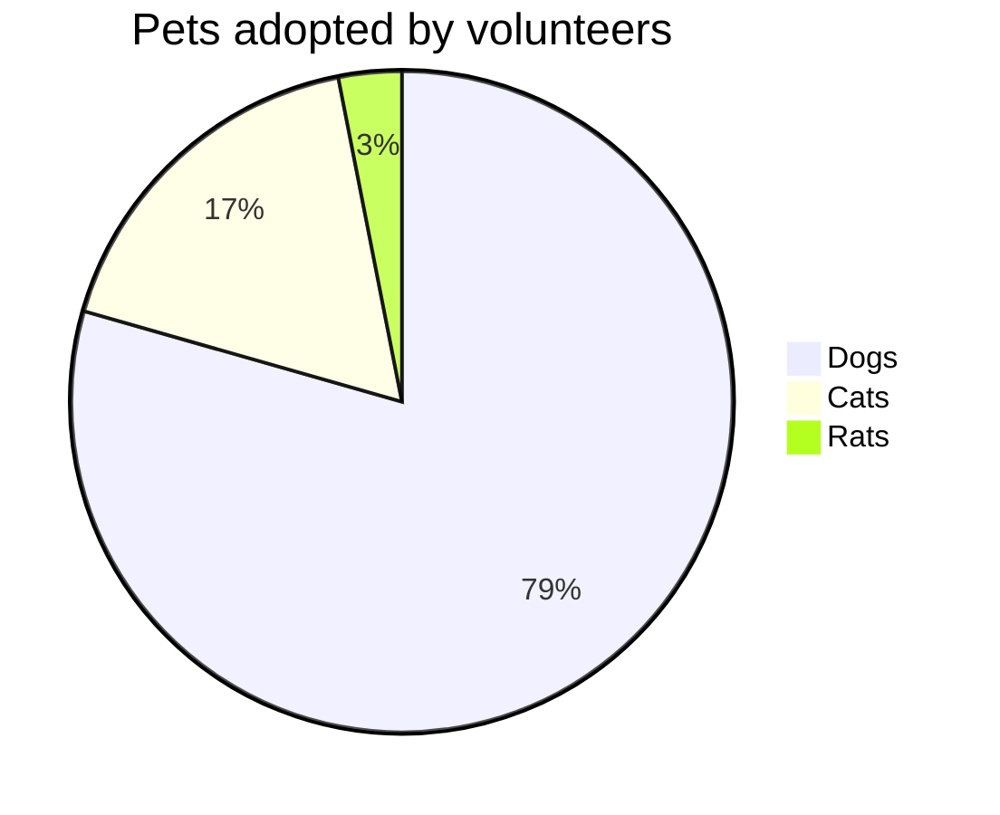

# Pie charts

sirene draws Mermaid pie charts (`pie`) as images and as text:

In the editor a pie chart is read-only on the drawing side.

## What is read

| Syntax | Drawn as |
|---|---|
| `pie` | slices largest first, clockwise from the top, with a legend to the right |
| `pie showData` | each value in the legend (`Dogs [386]`) and in the text form |
| `title text` | the title above, also on the header line (`pie title Pets`); frontmatter `title` too |
| `"label" : 42.5` | a slice; single quotes work too |

Each slice shows its share as a whole percent. As in Mermaid, a slice under 1% is not drawn (the
others fill the circle) but stays in the legend.

## Errors

A negative value is an error, and a label given twice is a warning; the slice is skipped and the
rest of the chart is drawn.

## Colors

Slice colors can be overridden with `themeVariables.pie1` to `pie12`; see [Themes](themes.md).

## Not drawn

`textPosition` is ignored.
