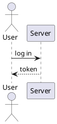

# PlantUML

sirene draws PlantUML diagrams as images and as text, with its own layouts:

A `.puml`, `.plantuml`, `.pu`, or `.iuml` file, a `plantuml` or `puml` block in Markdown, and any
source given with `--lang plantuml` is PlantUML; so is stdin or another file with an `@start`
line (text before it is ignored). Directories are scanned for those extensions. Inside
`@startuml`, the kind is picked from the statements, as PlantUML does. In the editor a PlantUML
diagram is read-only on the drawing side. Only the first `@start` ... `@end` block in a file is drawn.

## Kinds

| Kind | Start |
|---|---|
| Sequence | `@startuml` with participants and messages, and anything no other row matches |
| Activity, with swimlanes | `@startuml` with `start`, `:action;`, `if`, `while`, `fork`, `\|Lane\|` |
| Class and object | `@startuml` with `class`, `interface`, `enum`, `object`, `map` |
| State | `@startuml` with `state`, `[*]` |
| Use case, component, and deployment | `@startuml` with `usecase`, `(Name)`, `component`, `[Name]`, `node`, `cloud`, ... |
| Timing | `@startuml` with `robust`, `concise`, `clock`, `binary`, `analog` |
| Network | `nwdiag { ... }` in `@startuml` or `@startnwdiag` |
| Mindmap and WBS | `@startmindmap`, `@startwbs` |
| Gantt | `@startgantt`, or `@startuml` with `[Task] lasts ...` or `Project starts ...` |
| JSON and YAML | `@startjson`, `@startyaml` |
| DOT | `@startdot` |
| EBNF and regular expressions | `@startebnf`, `@startregex` |
| Chen entity-relationship | `@startchen` |
| Chronology | `@startchronology` |
| File trees | `@startfiles` |

`actor` and `database` alone do not pick a kind: a diagram of actors and arrows is a sequence
diagram until a use case or component appears. The [examples](examples.md) include a sequence,
class, activity, and timing diagram. See
`spec/plantuml.md` and the `spec/plantuml-*.md` pages for what each kind reads.

## Errors

Syntax a kind does not read is an error on its line; a construct that is read but not drawn
(a participant's stereotype, an unknown attribute, `manual time-axis`) is a warning.
`!include`, `!includeurl`, `!includesub`, `!include_many`, `!include_once`, and `!import` are
errors, since sirene reads no other files; other `!` lines (`!define`, `!theme`, ...) are
warnings and skipped. `skinparam` lines are warnings, except `skinparam actorStyle` in use case
diagrams. A second `@start` block in a file is a warning.

## Not drawn

Salt (`@startsalt`), ditaa, math, LaTeX, wire, board, creole, and def diagrams, and any other
`@start` word, are errors naming the kind. So is the older activity syntax (`(*) --> "First"`);
use `start` and `:action;`. The preprocessor (`!define`, `!function`, variables, conditionals)
is not evaluated: the lines in every `!if` branch are read as statements, and macro calls are
read as written, so they are usually errors on their own lines. The layouts are sirene's, not
PlantUML's.
