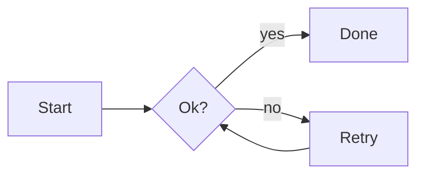

# Quickstart

Write a flowchart:



Save it as `diagram.mmd`, then:

```
sirene ascii diagram.mmd     # print it in the terminal
sirene svg diagram.mmd -o diagram.svg
sirene png diagram.mmd       # writes diagram.png
sirene diagram.mmd           # open it in the editor
```

`sirene` with no file opens a new document with a starter flowchart.

## In the editor

- Type in the source pane; the drawing follows as you type.
- Click a node to select it, double-click (or press enter) to edit its label.
- Drag from one node to another to connect them.
- Press secondary-shift-n to add a node after the selected one. Secondary is Cmd on macOS and
  Ctrl elsewhere.
- Press backspace to delete the selection, secondary-z to undo.
- Secondary-s saves.

Every change made in the drawing is an ordinary text edit to the source, so comments, spacing,
and statement order are kept. See [The editor](editor.md).

## Keeping images up to date

```
sirene png --watch docs/
```

writes a `.png` beside each diagram file (`.mmd`, `.mermaid`, `.dot`, `.gv`) under `docs/`, then writes it
again each time one changes. See [Command line](cli.md).
