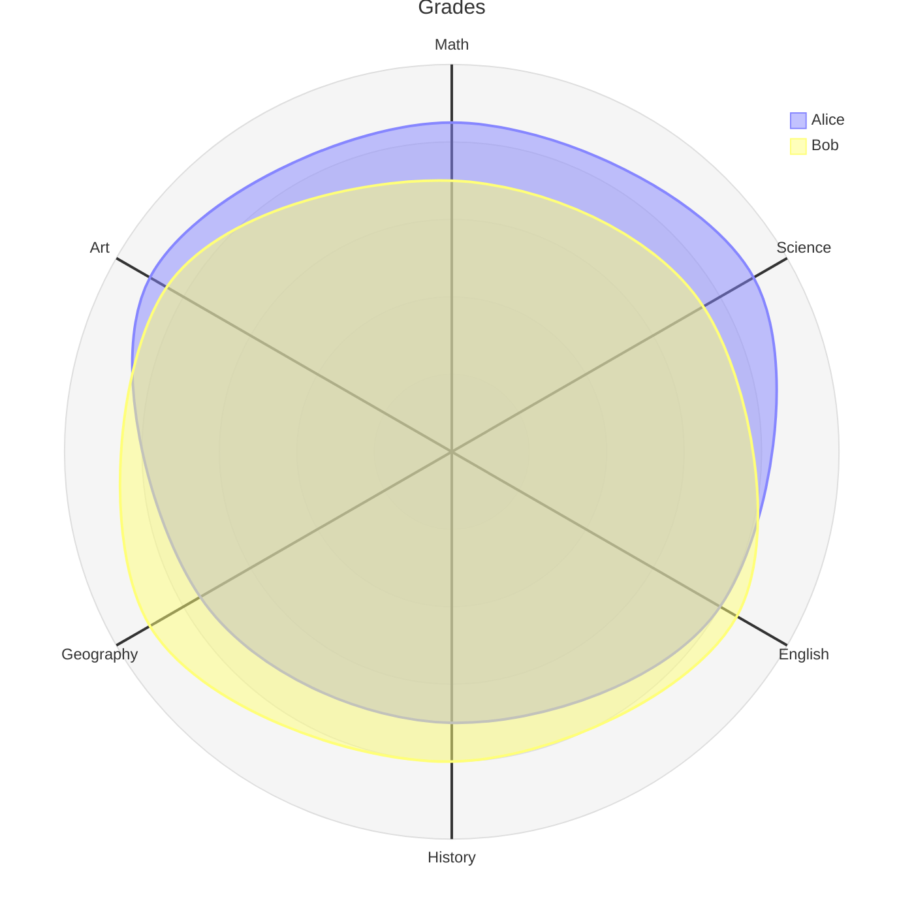

# Radar charts

sirene draws Mermaid radar charts (`radar-beta`) as images and as text. In text, each axis gets
a bar per curve, scaled from the minimum to the maximum:

In the editor a radar chart is read-only on the drawing side.

## What is read

| Syntax | Drawn as |
|---|---|
| `axis a["Label"], b` | axes from the center, the first pointing up and the rest clockwise; an axis without a label shows its id |
| `curve c["Label"]{1, 2, 3}` | a closed curve with a value per axis, in axis order |
| `curve c{b: 2, a: 1}` | values by axis id, in any order; the braces may span lines |
| `max 100`, `min 0` | the values at the rim and the center; `max` defaults to the largest value, `min` to 0 |
| `ticks 5` | the number of rings |
| `graticule circle`, `graticule polygon` | round rings, or rings with a corner on each axis |
| `showLegend false` | no legend |
| `title text`, frontmatter `title` | the title above |
| frontmatter `config.radar` | `width`, `height`, the four margins, `axisScaleFactor`, `axisLabelFactor`, and `curveTension` |

A value outside `min` to `max` sits on the center or the rim.

## Errors

A curve with fewer values than axes is an error, and the missing values sit at the minimum;
extra values are ignored. With keyed values, an id that is not an axis, a repeated id, a value
without an id, and a missing axis are errors. A repeated axis id, a `max` at or under `min`, and
an option with a bad value (`graticule square`, `ticks 0`) are errors; a bad `config.radar`
value is a warning.

## Colors

Curve colors can be overridden with `themeVariables.cScale0` to `cScale11`; see
[Themes](themes.md).

## Not drawn

`themeVariables.radar` is ignored.
