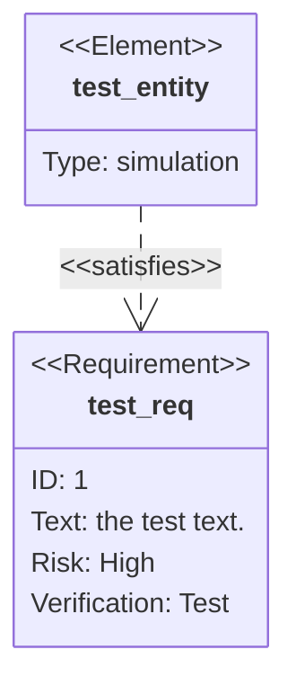

# Requirement diagrams

sirene draws Mermaid requirement diagrams (`requirementDiagram`) as images and as text:

In the editor a requirement diagram is read-only on the drawing side.

## What is read

| Syntax | Drawn as |
|---|---|
| `requirement name { ... }` | a box with `«Requirement»` above the name and its fields below |
| `functionalRequirement`, `interfaceRequirement`, `performanceRequirement`, `physicalRequirement`, `designConstraint` | the same, with that type above the name |
| `id:`, `text:`, `risk:`, `verifymethod:` | a requirement's fields |
| `element name { type: ..., docref: ... }` | a box with `«Element»` and its type and doc ref |
| `a - satisfies -> b`, `b <- satisfies - a` | a dashed arrow from `a` to `b` labeled `«satisfies»`; also `copies`, `derives`, `verifies`, `refines`, `traces` |
| `a - contains -> b` | a solid line from a circle at `a` |
| `"quoted name"` | a name or value with `:`, `-`, or other punctuation |
| `name:::cls`, `class a,b cls`, `classDef`, `style` | classes and styles, as in flowcharts |
| `direction LR` | the layout direction |

Keywords, field names, and relationship types match in any case. A risk is shown as `Low`,
`Medium`, or `High`, and a verify method as `Analysis`, `Inspection`, `Test`, or `Demonstration`.

## Errors

An unknown relationship type, an unclosed `{`, and a field without `:` are errors. A field the
type does not have (an element's `id`), an unknown risk or verify method, a class or style for an
unknown name, a relationship to a name that is never defined (drawn as a plain box), and a second
definition of a name (skipped; the first is kept) are warnings.

## Not drawn

`contains` uses a plain circle where Mermaid draws a circle with a plus. Mermaid's newer look and
ELK layout are not used, and markdown in names and values is shown as written.
