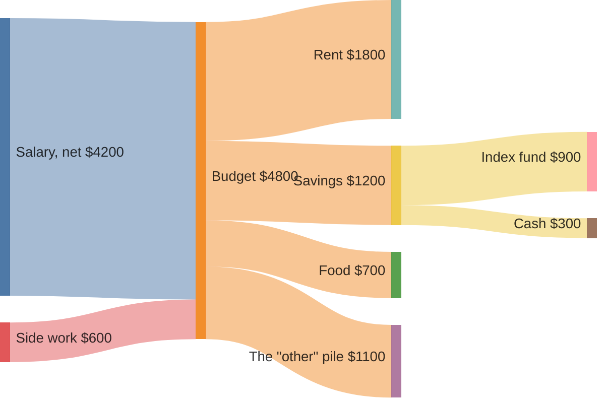

# Sankey diagrams

sirene draws Mermaid sankey diagrams (`sankey-beta`) as images and as text. In text, each node
lists its outgoing flows, with bars scaled to the largest flow:

In the editor a sankey diagram is read-only on the drawing side.

## What is read

| Syntax | Drawn as |
|---|---|
| `source,target,value` | a band from source to target as wide as the value; nodes are made on first use |
| `"a, b",c,1` | a quoted name may hold `,`; `""` is a literal `"` |
| frontmatter `title` | the title above |
| `config.sankey.linkColor` | `gradient` (the default), `source`, `target`, or a color such as `"#a1a1a1"` |
| `config.sankey.nodeAlignment` | `justify` (the default), `left`, `right`, or `center` |
| `config.sankey.showValues` | `false` leaves values out of the labels |
| `config.sankey.prefix`, `suffix` | text around each value, e.g. `"$"` or `" TWh"` |
| `config.sankey` | also `width`, `height`, `nodeWidth`, and `nodePadding` |

## Errors

A row that is not `source,target,value`, a value that is not a number, and a quoted name not
closed on its line are errors. A negative value, a node flowing into itself, and a row that
closes a cycle are errors and the row is left out. A bad `config.sankey` value is a warning.

## Not drawn

Theme variables are ignored.
