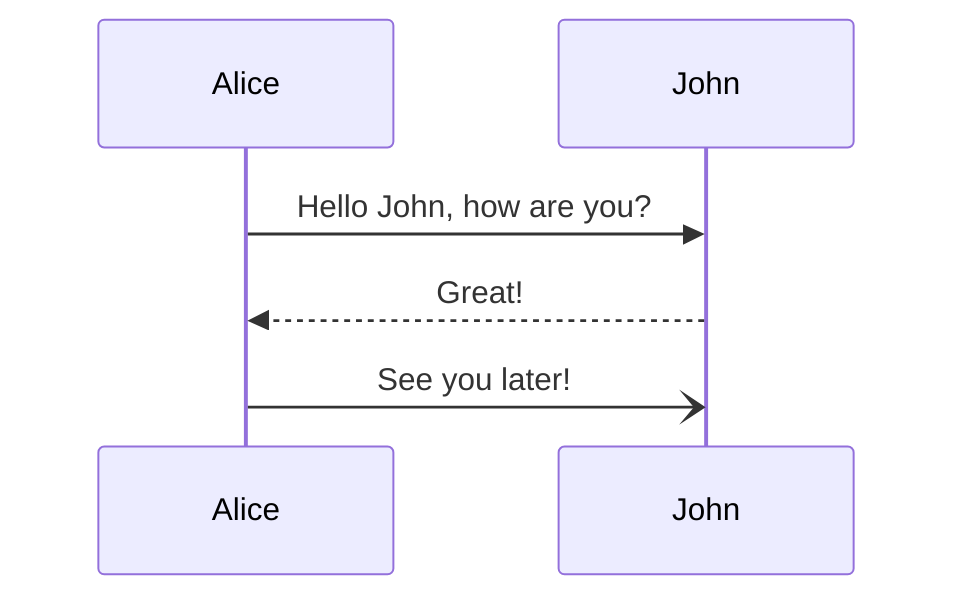

# Sequence diagrams

sirene draws Mermaid sequence diagrams (`sequenceDiagram`) as images and as text:

In the editor a sequence diagram is read-only on the drawing side.

## What is read

| Syntax | Drawn as |
|---|---|
| `participant A`, `participant A as Alice`, `actor A` | a box, or a stick figure, at the top and bottom of a lifeline |
| `participant A@{ "type": "database" }` | `boundary`, `control`, `entity`, `database`, `collections`, or `queue` shapes (boxes in text) |
| `A->>B: text` | a message; participants not declared are added in order of first mention |
| `->`, `-->`, `->>`, `-->>`, `-x`, `--x`, `-)`, `--)`, `<<->>`, `<<-->>` | solid or dotted lines with no head, a filled head, a cross, an open head, or heads at both ends |
| `A->>A: text` | a loop back to the same lifeline |
| `A->>+B`, `B-->>-A`, `activate A`, `deactivate A` | activation bars, offset when nested (heavy lifelines in text) |
| `note left of A`, `note right of A`, `note over A,B` | a note beside or across lifelines |
| `loop`, `alt`/`else`, `opt`, `par`/`and`, `critical`/`option`, `break` | a frame with its kind and label, and dashed dividers; frames nest |
| `rect COLOR ... end` | a colored background (a dotted frame in text) |
| `box COLOR Title ... end` | a group around the participants declared inside; it holds only declarations |
| `create participant B`, `destroy B` | a header where the participant is created, and a cross where its lifeline ends |
| `autonumber`, `autonumber 10 5`, `autonumber off` | a numbered badge on each message (`1. ` before the label in text) |
| `title text`, `accTitle`, `accDescr` | the title above (frontmatter `title` too) |
| ` `, `#59;` | a line break, and entity codes |
| `participant A; participant B` | `;` ends a statement as a newline does; write `#59;` for a literal one |

Keywords are matched in any case, so `Note over A` works.

## Errors

These are errors, and the rest of the diagram is drawn:
- deactivating a participant that is not active;
- `else`, `and`, or `option` outside its block;
- an `end` with nothing to close, or a block left open;
- `create` for a participant already mentioned;
- an `autonumber` that is not `off` or numbers.

A participant still active at the end is a warning.

## Not drawn

`link`, `links`, `properties`, and `details` are warnings and skipped. `wrap`, `par_over` (drawn as
`par`), and the `sequence` config options are ignored.
