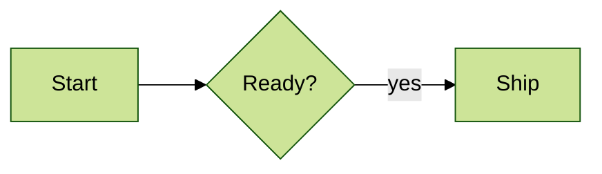

# Themes

A diagram can pick one of Mermaid's themes, and override its colors, in its frontmatter or in an
`%%{init}%%` directive. The diagram's theme replaces `--theme` and the editor's light or dark
setting when drawing it as an image.

The same in frontmatter, with `themeVariables`:

Themes: `default`, `base`, `dark`, `forest`, `neutral`, `neo`, `neo-dark`, `redux`,
`redux-dark`, `redux-color`, and `redux-dark-color`. An unknown name is a warning.

`themeVariables` work as in Mermaid: variables such as `primaryColor`, `primaryBorderColor`,
`primaryTextColor`, `lineColor`, `background`, `mainBkg`, `nodeBorder`, `clusterBkg`, and
`edgeLabelBackground` feed the colors the theme derives. With no `theme`, the variables apply to
the application's theme.

Note that text output is not themed, and chart palettes (pie slices, `cScale`) are not applied
yet.
