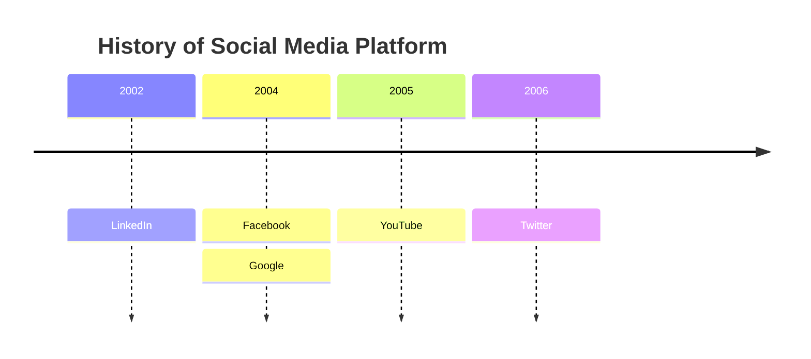

# Timelines

sirene draws Mermaid timelines (`timeline`) as images and as text:

In the editor a timeline is read-only on the drawing side.

## What is read

| Syntax | Drawn as |
|---|---|
| `timeline`, `timeline LR`, `timeline TD` | periods left to right with events below, or top to bottom with events to the right |
| `title text` | the title above (frontmatter `title` too) |
| `2002 : A : B` | a period and its events |
| `: C` on the next line | another event for the period above |
| `section name` | a box over the periods that follow, until the next `section` |
| ` ` | a line break; long text also wraps |

A `:` separates only when followed by a space or the end of the line, so `10:30 : standup` is the
period `10:30`. Each section has its own color; without sections, each period does.

## Errors

An event before any period and a `section` without a name are errors, and an empty event is a
warning; the rest of the timeline is drawn.

## Not drawn

`disableMulticolor` and the `cScale` theme colors are ignored.
