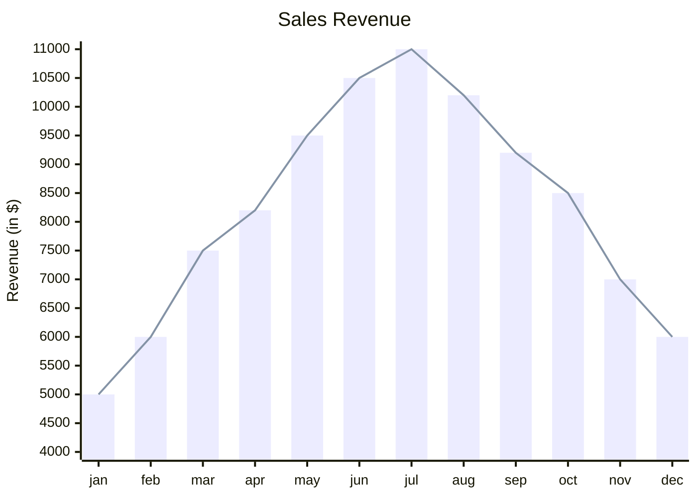

# XY charts

sirene draws Mermaid XY charts (`xychart-beta` and `xychart`) as images and as text:

In the editor an XY chart is read-only on the drawing side.

## What is read

| Syntax | Drawn as |
|---|---|
| `xychart-beta horizontal` | categories down the side and values across |
| `title "text"` | the title above; frontmatter `title` too |
| `x-axis "title" [a, "b c"]` | categories along the x-axis |
| `x-axis "title" 0 --> 10` | a numeric x-axis, with each series spread evenly across it |
| `y-axis "title" 0 --> 100` | the value axis's range; without one it spans the data |
| `bar [1, 2.5, -3]` | a bar per value, up from the bottom of the value axis |
| `line [1, 2, 3]` | a line through the values |
| `line "name" [...]`, `bar "name" [...]` | a named series, listed in the legend |
| `line [540 "PaLM", 65]` | a label beside a point |
| `accTitle`, `accDescr` | kept in the model |

A title or name with spaces needs quotes. Without an `x-axis`, positions are numbered from 1.
Series take colors in order and later ones draw over earlier ones, as in Mermaid.

In text, each x position is a row, with a bar per bar series and a marker per line series,
scaled across the value axis, whose span is printed under the table.

## Errors

A malformed list or range is an error, and its statement is skipped. A range written high to
low (`10 --> 0`) is a warning and turned around. Categories on the y-axis are an error. Values
beyond the number of categories are a warning and are not drawn.

## Not drawn

Frontmatter `config` for `xyChart` (sizes, `showDataLabel`, `showLegend`, axis settings) and
theme variables such as `plotColorPalette` are ignored.
