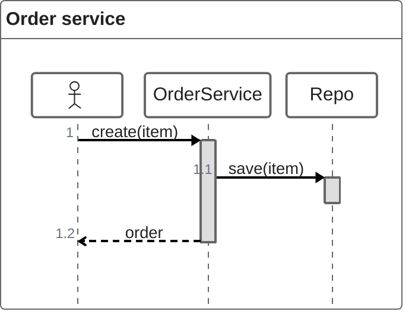

# ZenUML diagrams

sirene draws ZenUML sequence diagrams (`zenuml`) as images and as text, the same way it draws
[sequence diagrams](sequence.md). A call such as `A.method()` activates `A` for its body, and a
call with no caller comes in from the left:

See `crates/sirene-core/tests/fixtures/zenuml/valid/` for annotators, creations, replies, and
fragments. In the editor a ZenUML diagram is read-only on the drawing side.

## What is read

| Syntax | Drawn as |
|---|---|
| `A`, `A as Label`, `"A B"` | a participant, in order of appearance |
| `@Actor A`, `@Database A`, `@Boundary A`, `@Control A`, `@Entity A`, `@Queue A`, `@Collections A` | a participant drawn as that symbol |
| `@Starter(A)` | `A` as the caller of calls that name none |
| `A->B: text` | an async message (an open arrowhead) |
| `@return` or `@reply` before `A->B: text` | a dotted reply |
| `A.method(args)`, `C->A.method(args)` | a sync call from the current caller (or `C`), activating `A` |
| `... { ... }` after a call | the statements inside, called from `A` |
| `x = A.method()`, `Type x = A.method()` | a dotted reply `x` when the call ends |
| `return x` | a dotted reply `x` from the call it is inside |
| `new A(args)`, `a = new A()` | `A`'s header drawn here, and a `<<create>>` call |
| `if(c) {` ... `} else if(d) {` ... `} else {` ... `}` | an `alt` block with dividers |
| `while(c)`, `for(c)`, `forEach(c)`, `foreach(c)`, `loop(c)` | a `loop` block |
| `opt {`, `par {` | an `opt` or `par` block |
| `try {` ... `} catch(e) {` ... `} finally {` ... `}` | a `try` block with dividers |
| `title`, frontmatter `title` | the title above |
| `// comment` | read, not drawn |

## Errors

A statement that is none of the above, an unclosed `(`, `"`, or `{`, a stray `}`, a `.` without
a method, `new` without a participant, a fragment without `{`, and extra text after a statement
are errors, and the statement is not drawn. An annotator other than those above is a warning and
the participant is drawn as a box. `return` outside a call, and `@return` not followed by an async
message, are warnings and ignored.

## Not drawn

Comments are not drawn above messages, and Markdown in them is not rendered. Participant groups,
stereotypes, colors, widths, dividers (`==text==`), and icon annotators (`@EC2`, ...) are not
read.
